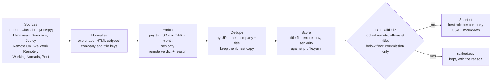

# job-hunt-pipeline

**I scanned 1,014 "remote" job ads in one run. 639 of them (63%) were not open to someone living in South Africa. Only 95 (9%) clearly were.**

The rest (28%) never said where they hire. For the roles I was targeting (GTM, RevOps, growth and sales titles), it was worse: 292 of 395 (74%) were locked to another country.

I ran my own job hunt like an outbound campaign. This repo is the pipeline: source job ads from public boards, enrich them, score them against a profile, throw out the ones I can't take, and hand me a ranked shortlist. It is the same job as building a prospect list.

Run date: 10 November 2026. Ads from the previous 7 days, 6 search terms, 9 boards. Full counts are in [`sample/full-run-summary.json`](sample/full-run-summary.json).

## How it works



| Step | Module | What it does |
|---|---|---|
| Source | [`jobhunt/sources/`](jobhunt/sources) | Pulls ads from public feeds and JobSpy. One board failing never stops the run. |
| Normalise | [`normalise.py`](jobhunt/normalise.py) | One row shape for every board. `Acme, Inc.` and `ACME (YC W24)` both become `acme`. |
| Enrich | [`pay.py`](jobhunt/pay.py), [`seniority.py`](jobhunt/seniority.py), [`remote.py`](jobhunt/remote.py) | Pay in dollars and rand a month. Seniority from the title. The remote verdict, with its reason. |
| Dedupe | [`dedupe.py`](jobhunt/dedupe.py) | The same job shows up on three boards. Keeps the copy with the best evidence and lists where it was seen. |
| Score | [`score.py`](jobhunt/score.py) | Points out of 100, plus disqualifiers. Every point has a reason. |
| Report | [`report.py`](jobhunt/report.py) | `ranked.csv` (everything), `shortlist.csv`, `shortlist.md`, `summary.json`. |

## The fake-remote detector

Job boards answer "can this job be done from home?" A job seeker needs "can it be done from *my* home?" Most "remote" ads fail that test. They want US residence, a UK right to work, a clearance, or a seat tied to a sales territory.

[`check_remote_eligibility()`](jobhunt/remote.py) reads the evidence in a fixed order, strongest first, and returns a verdict (`open`, `locked` or `unclear`) with the words that decided it:

1. **Title names a territory.** "Account Executive, US East" is locked, whatever the board says.
2. **The ad has a lock clause.** "Authorized to work in the United States", "Remote (US only)", "must reside in", "security clearance".
3. **The board's scope field.** Himalayas, Remotive and Jobicy have a structured "who can apply" field. It beats free text.
4. **The location field.** "Austin, TX, US" is locked. "Johannesburg, South Africa" is open.
5. **The ad says it hires in your region.** "Remote - EMEA", "Location: Worldwide", "work from anywhere".

If none of these fire, the verdict is `unclear: read the ad`. Unclear is not open.

What broke the locks in this run:

| Reason | Ads |
|---|---|
| Location field names another country or city | 249 |
| Board scope field excludes South Africa | 211 |
| Title names a territory | 97 |
| Ad text has a residence, permit or clearance clause | 82 |

Two rules came from reading the output of a live run, not from planning:

- **"Worldwide" in ad text is usually about the company.** "80,000 customers worldwide" and "offices worldwide" don't open a job. A region word in the text now counts only next to a hiring word ("remote", "location", "based", "hiring", "candidates").
- **A country in a title isn't always a territory.** On the South African board, "Patient Coordinator, US Healthcare" and "Bookkeeper, USA Hours" are SA seats serving US clients. A territory word followed by "hours", "healthcare", "clients" or a time zone is skipped.

Both are covered by tests.

## Decisions

- **Every flag carries its reason.** A regex will be wrong sometimes. When it is, the reason column shows why in one glance, so a person can overrule it.
- **Unknown is its own bucket.** Ads that don't say where they hire, or don't list pay, get partial credit. They are not dropped. Only 33% of ads in this run listed pay, and many good ones don't.
- **Structured fields beat text.** A board's scope field is trusted over the ad body. The one exception is We Work Remotely, which labels almost every ad "Anywhere in the World", including US-only seats. That label is ignored.
- **Pay goes through dollars at ECB rates** (via frankfurter.dev), with a fixed fallback table when offline. Hourly, daily, weekly and monthly figures are annualised first. Anything over $40,000 a month is treated as an OTE fantasy or a parsing error and dropped, not guessed.
- **Dedupe keeps the best copy, not the first.** A job seen on Indeed and Himalayas keeps the Himalayas copy, because it has a scope field.
- **One row per company in the shortlist**, with a count of its other matching roles. That is the account-level view, not the lead-level view.
- **The profile is config, not code.** Target titles, the pay floor, the region and the weights live in [`profile.example.yaml`](profile.example.yaml). Someone in Brazil changes `open_markers` to `["brazil", "latam", "worldwide"]` and the detector works for them.
- **No LinkedIn.** JobSpy can read LinkedIn's public job pages, and my private version did. LinkedIn's terms forbid scraping, so this repo leaves it out. `jobspy_boards.BLOCKED_SITES` drops it even if someone adds it to the profile.

## Honest limits

- **Boards block.** Glassdoor and Google Jobs block scrapers quickly. Google Jobs returned nothing on every run in October 2026, so it is off. Glassdoor has no South Africa site, so it returned nothing there. Indeed is the most tolerant, but its job pages put a Cloudflare check in front of the apply button.
- **Rate limits.** Fewer search terms per run is the fix. LinkedIn answered HTTP 429 when my private runs pushed it.
- **Jobicy answers HTTP 400 when a tag has no jobs**, instead of an empty list. The code skips that term now. The first live run lost Jobicy entirely until that fix.
- **Pnet has no API.** The code reads the JSON embedded in its search page. If Pnet changes its layout, that source fails with "result list not found".
- **Remote OK's location field is often a bare city** ("Montreal,"). The detector doesn't know every city, so those land in `unclear`.
- **It is regex.** It does not read like a person. It misses language requirements ("Dutch speaking") and treats time-zone demands ("must work EST hours") as a fit question, not a lock.
- **One run is one snapshot.** The 63% is from 10 November 2026 with 6 search terms. The [sample](sample) is stratified across boards and verdicts, so its own percentages are not the headline's.

## Run it

```bash
pip install -e ".[dev]"
```

```bash
cp profile.example.yaml profile.yaml
```

```bash
python -m jobhunt run --profile profile.yaml --out out/
```

Re-run the committed sample offline, no scraping:

```bash
python -m jobhunt run --from-csv sample/postings.csv --out out/ --offline-rates
```

```bash
pytest
```

Flags: `--no-jobspy` skips Indeed and Glassdoor, `--boards himalayas pnet` picks boards, `--save-raw raw.csv` keeps the raw rows for an offline re-run.

### The sample

[`sample/postings.csv`](sample/postings.csv) holds 50 public job ads from the 10 November run, spread across boards and verdicts. Each ad is trimmed to the window around the evidence the detector used, so the verdicts re-compute the same from the sample as from the full ads. Recruiter emails and phone numbers are stripped. [`scripts/make_sample.py`](scripts/make_sample.py) builds it from a raw run. [`sample/output/`](sample/output) is the pipeline's output on it. Remotive, Remote OK and Jobicy ask for a credit and a link back when their jobs are shared: the `job_url` column is that link.

## What happened when I used it

The pipeline found the ads. I still read every shortlisted ad in full before applying. Over about three and a half weeks (14 October to 6 November 2026):

| Stage | Count | Rate |
|---|---|---|
| Sourced (unique ads across all runs) | 7,170 | |
| Shortlisted and read in full | 138 | 1.9% of sourced |
| Applied | 59 | 43% of shortlisted |
| Replies | 5 | 8.5% of applied |
| Interviews (screening calls) | 1 | 1.7% of applied, 20% of replies |

Notes: the sourced count includes LinkedIn's public job pages, which my private runs used. "Shortlisted" counts tracker entries; a few entries cover more than one role. Replies include rejections. Of the 79 shortlisted ads I didn't apply to, many failed on a detail the pipeline can't see: years in a specific field, a required essay or video, an account sign-up, or a role that had closed. Others were location locks or pay gaps the regex missed and the full ad showed.

The lesson is the same as in outbound. The list was never the bottleneck. Disqualifying fast saved the time, and the reply rate is the number to judge the whole thing by.

## The GTM parallel

| Job hunt | Prospect list |
|---|---|
| Scrape job boards | Source accounts from directories, intent data, job posts |
| Normalise board formats | Clean CRM and enrichment-vendor fields into one schema |
| Convert pay to one currency | Normalise revenue, headcount and funding to comparable units |
| Fake-remote detector | Disqualify accounts outside your territory or ICP, and say why |
| Score against `profile.yaml` | Score fit against an ICP definition that lives in config |
| Dedupe across boards | Dedupe leads and roll them up to accounts |
| Best role per company | Best contact per account |
| Shortlist, then read every ad | Tiered list, then research before the first touch |
| 8.5% reply rate | Benchmark your sequence the same way |

Sourcing, enrichment, scoring and disqualification are the same work whether the target is an employer or a buyer. The part that matters most is the same too: say why every row was kept or dropped, so a person can trust the list.

## Tests

78 tests: the remote detector (including the false positives found in the live run), pay parsing and conversion (including "R38 000" with a space), text clean-up, scoring and disqualifiers, seniority, dedupe, and the pipeline end to end.

```bash
pytest -q
```

Built with Claude Code. MIT licence.
